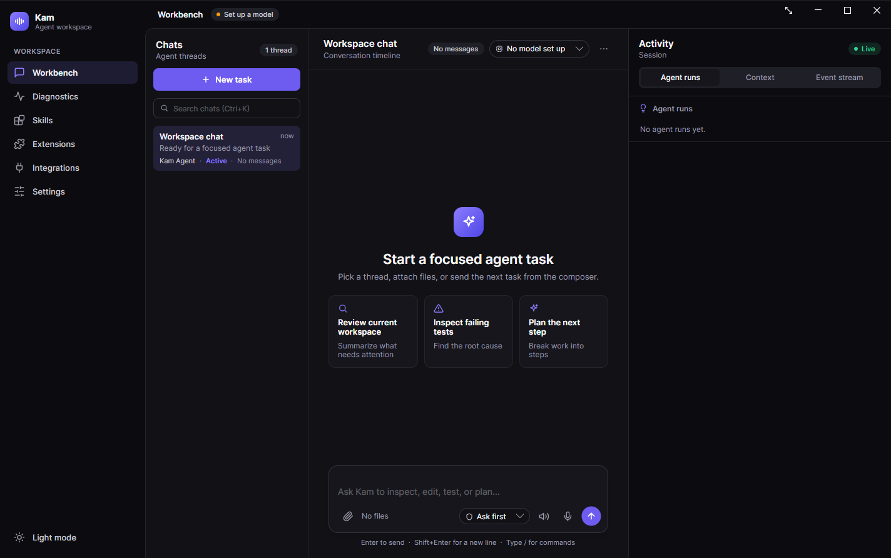
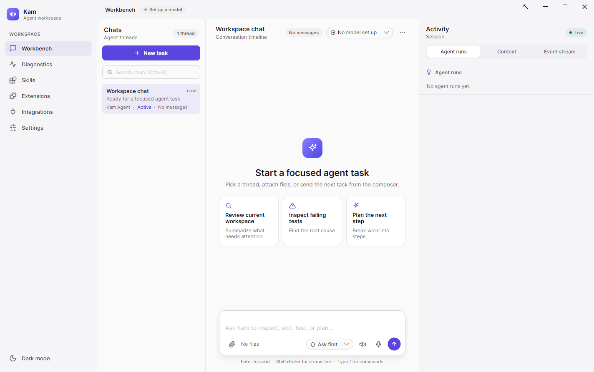
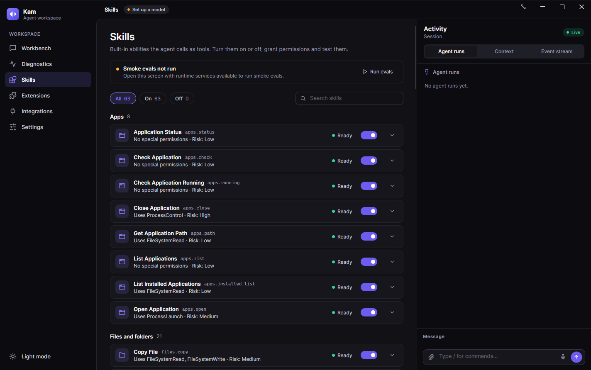
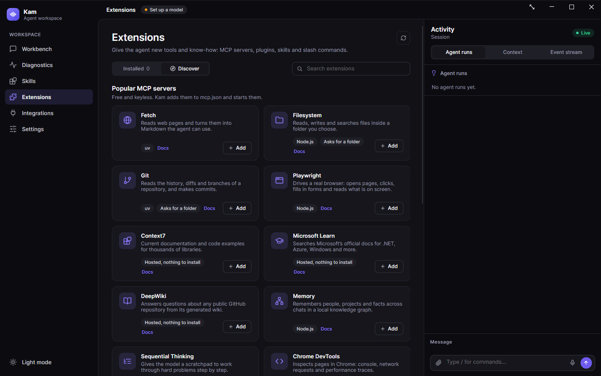
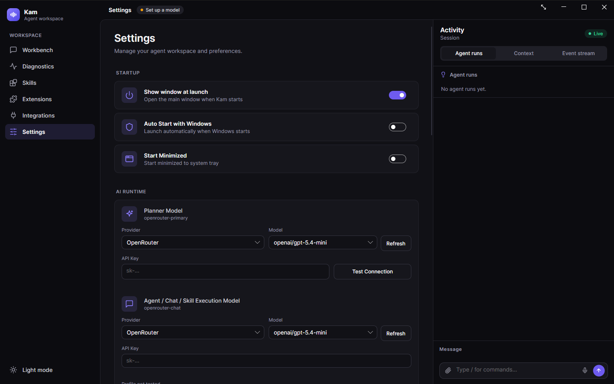

# Kam

Kam is a desktop AI agent for Windows. You talk or type to it, and a model calls tools to act on your machine: open apps, read and edit files, run shell commands, search the web, and use any MCP server you add. Every tool call goes through a permission check you control.

This is an early pre-release (v0.1.0), built by one person. Windows only for now.

[](https://github.com/Esquetta/Kam/actions/workflows/dotnet.yml)
[](https://dotnet.microsoft.com/)
[](https://avaloniaui.net/)
[](LICENSE)

## Screenshots

<p align="center">
  
</p>
<p align="center">
  
</p>
<p align="center">
  
</p>
<p align="center">
  
</p>
<p align="center">
  
</p>

## Download

Get `Kam-0.1.0-win-x64.zip` from the [v0.1.0 pre-release](https://github.com/Esquetta/Kam/releases/tag/v0.1.0); newer builds are listed under [Releases](https://github.com/Esquetta/Kam/releases). A `.sha256` file sits next to it.

- Windows 10/11 x64. The build is self-contained, so no .NET install is needed.
- About 106 MB to download, about 260 MB unpacked. Unzip anywhere and run `Kam.exe`.
- The build is not code-signed. Windows SmartScreen may warn; choose "More info" > "Run anyway".
- First run: the title bar shows "Set up a model". Open Settings > AI Runtime, pick a provider and a model. Until then, chat replies with a message asking you to set one up.
  - Providers: OpenRouter, OpenAI, Anthropic, Ollama, or any OpenAI-compatible endpoint. Ollama at `http://localhost:11434/v1` needs no key.
- Settings are stored in `%LocalAppData%\SmartVoiceAgent` and `%AppData%\Kam`. API keys are encrypted with Windows DPAPI for the current user.
- There is no installer and no auto-start. Delete the folder to uninstall.

## How it works

Chat, voice commands and the tray's "New task" all run through one tool-calling agent loop (`IAgentRuntime`):

```
user input -> AgentRuntime -> model <-> tools -> reply
                                        |- built-in skills (files, shell, apps, web, clipboard, windows, ...)
                                        |- MCP servers
                                        |- Agent Skills (SKILL.md, loaded on demand)
                                        |- your Codex CLI (cli_agent_run, optional)
```

- **Permissions.** Every tool call passes `IToolPermissionService`. Modes are Ask, Auto-edit and Full auto, plus "always allow" and deny rules such as `shell_run(git status:*)` or `mcp__github__*`. Deny rules win, and allow rules never match chained shell commands. `ShellCommandGuard` blocks destructive shell commands by command position.
- **Sessions.** Threads persist as JSON under `%AppData%\Kam\sessions`. Each thread can use its own model.
- **Context.** `AgentContextWindow` keeps requests under a token budget by shortening old tool results and then inserting a summary message. `/compact` forces it.
- **MCP host.** Reads `%AppData%\Kam\mcp.json` (Claude Desktop format) and plugin `.mcp.json` files; tools appear as `mcp__{server}__{tool}`. The Extensions page can add well-known keyless servers.
- **Codex CLI.** Switch on Integrations > Coding agent CLIs and the agent can hand a coding task to your installed, signed-in Codex CLI (`codex exec --json`), so the work runs on your ChatGPT plan instead of an API key. Kam asks the CLI for its version and sign-in state and never reads its credentials. Runs are read-only unless the agent asks for edits, and every run needs your approval, even in Full auto, because Kam cannot gate the commands Codex runs. Claude Code is detected but not offered: Anthropic's terms do not clearly allow another app to use a Claude plan through the CLI.
- **Extensions.** Agent Skills, Claude Code layout plugins and Markdown slash commands load from disk and are managed on the Extensions page.
- **Voice.** Push to talk, an optional "Hey Kam" wake phrase, and spoken replies. Speech-to-text runs on local Whisper models (downloaded on first use, Vulkan GPU with CPU fallback) or an OpenAI-compatible transcription endpoint.
- **Interface.** English and Turkish.
- **Legacy fallback.** With `AgentRuntime:Enabled=false`, commands go through a single-skill JSON planner instead of the agent loop.

Design notes and roadmap: [docs/architecture/agent-platform.md](docs/architecture/agent-platform.md).

## What it does not do yet

- **One agent, one loop.** A turn stops when the model stops calling tools, after 24 steps, or when you cancel. There is no retry or backoff on model errors, no cost budget and no self-check pass.
- **No subagents or workflows in the loop.** Tool calls run one after another. Parallel subagents and a `task` tool are on the roadmap, not in the code.
- **The agent cannot extend itself.** You install skills, plugins and MCP servers from the Extensions page; the agent has no tool for it.
- **Evals cover short tasks.** 38 smoke cases check that built-in skills run, and a [skill routing eval](evals/skill-routing/README.md) checks that models pick the right skill for 48 one-step requests, and an [agent task eval](evals/agent-tasks/README.md) runs 16 multi-step file tasks through the real agent loop in a sandbox. Nothing yet measures long tasks, the shell or answer quality.
- **Hooks and long-term memory** are described in the roadmap only.

## Build from source

Requires Windows 10/11 and the .NET 9 SDK.

```powershell
git clone https://github.com/Esquetta/Kam.git
cd Kam
dotnet restore Kam.sln
dotnet build Kam.sln --configuration Release
dotnet run --project src/Ui/SmartVoiceAgent.Ui/SmartVoiceAgent.Ui.csproj --configuration Release
```

Then configure a model in Settings > AI Runtime.

`scripts/package-release.ps1 -Version 0.1.0` builds the release zip and its SHA-256 file. Pushing a `v*` tag runs the same script in CI and publishes the release.

## Secrets

Never commit API keys. Use the Settings page, .NET user secrets, or environment variables:

```powershell
dotnet user-secrets set "AIService:Provider" "OpenAI" --project src/Ui/SmartVoiceAgent.Ui
dotnet user-secrets set "AIService:ApiKey" "your-api-key" --project src/Ui/SmartVoiceAgent.Ui
dotnet user-secrets set "AIService:ModelId" "selected-model-id" --project src/Ui/SmartVoiceAgent.Ui
dotnet user-secrets set "AIService:Endpoint" "https://api.openai.com/v1" --project src/Ui/SmartVoiceAgent.Ui
```

Optional integrations (Todoist, SMTP email, Twilio SMS, a Google Custom Search key, a GitHub App for read-only repository discovery) are configured the same way or on the Integrations page.

## Development

```powershell
dotnet build Kam.sln --configuration Release
dotnet test tests/SmartVoiceAgent.Tests
.\scripts\local-production-smoke.ps1 -Configuration Release -Runtime win-x64
```

The smoke script runs restore, build, tests, a headless skill smoke and publish; CI runs it too. See [docs/local-production-smoke.md](docs/local-production-smoke.md). Architecture and conventions for contributors are in [AGENTS.md](AGENTS.md).

## Security model

Kam runs tools with your user's permissions, so treat it accordingly.

- Tool calls need approval according to the selected permission mode; deny rules always win.
- Shell commands are checked by `ShellCommandGuard`; file paths, application names and URLs are validated before use (`SecurityUtilities`).
- API keys are kept in the user secret store (DPAPI-encrypted), and are masked in logs.
- Plugins, MCP servers and Agent Skills you install run with the same access as you do. Install only ones you trust.
- A task handed to the Codex CLI runs under Codex's own sandbox (read-only, or workspace-write when edits are allowed) and its own rules. Kam shows what Codex changed afterwards but cannot approve its steps one by one.

Report vulnerabilities as described in [SECURITY.md](SECURITY.md).

## License

MIT. See [LICENSE](LICENSE).
